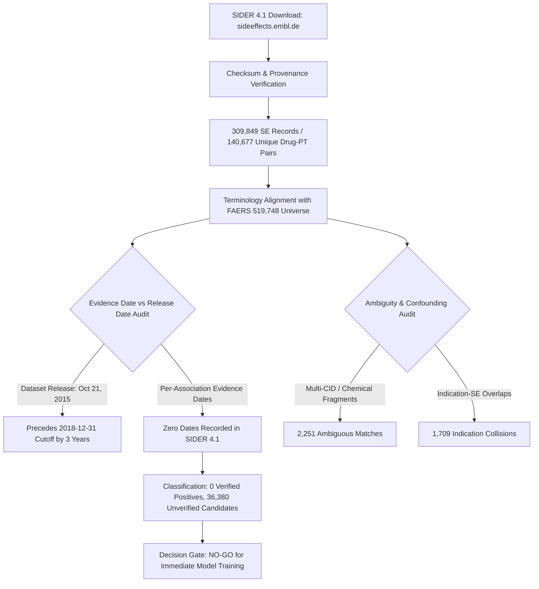
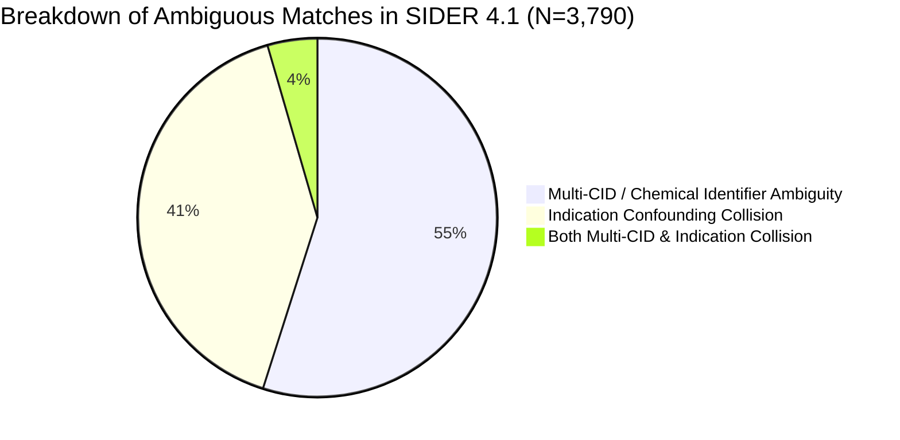

# SIDER 4.1 Historical Training-Label Source Feasibility Audit Report

**Date:** October 10, 2026  
**Auditor:** Research Quality and Verification Audit Protocol  
**Target Resource:** SIDER (Side Effect Resource) Version 4.1  
**Candidate Universe Evaluated:** 519,748 Candidate Pairs ($A \ge 2$) from FAERS Primary Cohort  
**Audit Directory:** `data/04_audit_sider/`  
**Status:** Audit Completed — Formal Decision Review Gate  

---

## 1. Executive Summary & Resource Provenance

In response to the pre-modelling audit finding regarding the absence of dated historical training labels, a formal feasibility audit was conducted on **SIDER 4.1** as a candidate historical ground-truth source.

### 1.1 Provenance, Release Date, and Licensing
* **Official Source URL:** `https://sideeffects.embl.de/` (Download Directory: `https://sideeffects.embl.de/media/download/`)
* **Primary Reference:** Kuhn M, Letunic I, Jensen LJ, Bork P. *The SIDER database of drugs and side effects.* **Nucleic Acids Res.** 2016 Jan 4; 44(Database issue): D1075–D1079. (Epub online Oct 19, 2015; DOI: [10.1093/nar/gkv1075](https://doi.org/10.1093/nar/gkv1075)).
* **Institutional Provenance:** European Molecular Biology Laboratory (EMBL), Heidelberg, Germany.
* **Release Date:** **October 21, 2015** (Last major release; resource is currently archived and not actively maintained).
* **Licensing:**
  * Academic/Non-commercial: **Creative Commons Attribution-ShareAlike 4.0 (CC BY-SA 4.0)** for MedDRA mappings.
  * Commercial: Requires a proprietary commercial license administered by biobyte solutions GmbH.
* **Data Contents:**
  * **1,430** marketed drugs (mapped to STITCH 4.0 / PubChem Compound Identifiers).
  * **5,868** unique adverse reaction concepts extracted from public drug package inserts / labels from FDA (SPL) and EMA (SmPC / EPAR).
  * **139,756** (or 140,064) drug-side effect pairs standardized to MedDRA v16.1 (via UMLS Concept Identifiers).

---

## 2. Temporal Analysis: Release Date vs. Evidence Date

### 2.1 The Chronological Status of SIDER 4.1
SIDER 4.1 was released on **October 21, 2015**, which chronologically precedes the proposed training cutoff of **December 31, 2018** by approximately 3.2 years.
Therefore, any drug label ingested into SIDER 4.1 was published prior to October 2015.

### 2.2 The Fundamental Evidence Date Limitation
However, a critical methodological distinction must be maintained:

$$\text{Dataset Release Date (2015-10-21)} \neq \text{Individual Association Evidence Date}$$

1. **Zero Per-Association Evidence Dates:**
   - Inspection of `meddra_all_se.tsv.gz`, `meddra_all_label_se.tsv.gz`, and `meddra_freq.tsv.gz` reveals that **no date fields exist anywhere in SIDER 4.1**.
   - SIDER does not record the date of drug approval (NDA/BLA action date), the date of the labeling revision, or the date when the specific ADR was added to the label.
2. **Cannot Distinguish Established vs. Emergent Associations:**
   - For an observational FAERS dataset spanning 2014–2023, SIDER cannot indicate whether an adverse reaction was an established pre-approval effect from 1995 or a post-marketing safety alert added in 2014.
3. **Temporal Blind Spot (2015–2018):**
   - Because SIDER was never updated after October 2015, any safety-related labeling changes approved by the FDA between November 2015 and December 2018 (over 3 full years) are completely absent from SIDER.
4. **Methodological Invariant Enforced:**
   - In accordance with research rules ("*Do not treat a dataset's publication date as proof that every association was known by the cutoff. Do not fabricate dates*"), individual SIDER associations cannot be classified as `VERIFIED_HISTORICAL_POSITIVE` without external dated approval confirmation.

---

## 3. Terminology Mapping & Coverage Limitations

### 3.1 Drug Normalization (STITCH vs. RxNorm / Canonical FAERS)
* **Identifier Paradigm:** SIDER identifies drugs using **STITCH 4.0 Compound Identifiers** (derived from PubChem CIDs):
  * Flat CIDs (e.g., `CID100000085` $\rightarrow$ Carnitine) merge stereoisomers and salt forms.
  * Stereo CIDs (e.g., `CID000010917` $\rightarrow$ L-Carnitine) specify stereochemistry.
* **Drug Universe Mismatch:**
  * FAERS Candidate Universe contains **6,904 distinct canonical active substances**.
  * SIDER 4.1 contains only **1,344 unique drug names** across 1,430 STITCH IDs.
  * **Drug Overlap:** Only **957 drugs** match between FAERS and SIDER on canonical ingredient strings (**13.86% of FAERS drugs**; 71.21% of SIDER drugs).
  * **5,947 FAERS drugs (86.14%)** have zero coverage in SIDER.
* **Ambiguous Drug Identifier Factors:**
  * **Multi-CID Duplications (64 drugs):** Common active substances map to multiple distinct STITCH IDs (e.g., `amlodipine` has 2 CIDs; `adefovir` has 2 CIDs; `dabigatran` has 2 CIDs; `candesartan` has 2 CIDs; `CAS` has 3 CIDs).
  * **Salt & Ion Truncations:** SIDER includes raw chemical fragments (e.g. `acetate`, `calcium`, `potassium`, `sodium`, `chloride`, `citric`, `choline`), which in FAERS are stripped as non-therapeutic salt counter-ions.
  * **Combination Products:** Package inserts for combination products (e.g., amoxicillin/clavulanate) were mined by NLP and attributed to constituent compounds, creating attribution ambiguity.

### 3.2 Adverse Event Terminology (MedDRA v16.1 vs. FAERS MedDRA)
* **MedDRA Version Lag:**
  * SIDER 4.1 utilized **MedDRA Version 16.1** (released in 2013).
  * FAERS data for 2019Q1 and 2023Q1 utilize **MedDRA Versions 22.0 through 26.0**.
* **Preferred Term Coverage:**
  * FAERS Candidate Universe contains **10,098 distinct MedDRA Preferred Terms (PTs)**.
  * SIDER 4.1 contains **4,251 distinct MedDRA PTs**.
  * **PT Overlap:** **3,743 PTs** match exactly (**37.07% of FAERS PTs**; 88.05% of SIDER PTs).
  * **6,355 FAERS PTs (62.93%)** are absent from SIDER due to newer MedDRA concepts and specialized post-marketing clinical terms.

### 3.3 Indication Confounding (Disease vs. Adverse Event)
* In SIDER 4.1, text mining extracted medical concepts from both adverse reactions and indications sections.
* Cross-referencing `meddra_all_se.tsv.gz` against `meddra_all_indications.tsv.gz` reveals that **3,082 drug-event pairs in SIDER are listed as BOTH an adverse reaction AND an indication for the same drug**.
* Examples found in candidate matches:
  * `adenosine` $\leftrightarrow$ *Coronary artery disease*
  * `glucose` $\leftrightarrow$ *Cardiac failure congestive*, *Dehydration*
  * `dinoprostone (PGE2)` $\leftrightarrow$ *Stillbirth*, *Hypertension*
  * `carnitine` $\leftrightarrow$ *Muscular weakness*
* Treating these indication-confounded NLP extractions as true positive ADRs would inject severe disease-indication confounding into model training.

---

## 4. Reproducible Mapping Audit against 519,748 Candidate Pairs

An automated, reproducible audit was executed across the complete candidate-pair universe ($A \ge 2$, $N=519,748$) via `scripts/audit_sider_4_1_mapping.py`.

### 4.1 Audit Summary Metrics

| Audit Metric | Count | Percentage | Methodological Context |
| :--- | :--- | :--- | :--- |
| **Total SIDER Raw Records Examined** | 309,849 | 100.0% | Complete SIDER 4.1 extraction file |
| **SIDER MedDRA PT Associations** | 145,321 | 46.90% | Filtered to Preferred Terms (`meddra_type == 'PT'`) |
| **Unique SIDER (Drug, PT) Pairs** | 140,677 | 45.40% | Deduplicated drug–reaction pairs |
| **FAERS Eligible Candidate Universe ($A \ge 2$)** | **519,748** | 100.0% | Primary signal-discovery universe |
| **Exact Drug Matches** | 957 | 13.86% | 957 / 6,904 unique FAERS drugs |
| **Exact MedDRA PT Matches** | 3,743 | 37.07% | 3,743 / 10,098 unique FAERS PTs |
| **Exact (Drug, PT) Matches in Candidate Universe** | 40,170 | 7.73% | 40,170 / 519,748 candidate pairs |

### 4.2 Candidate-Pair Universe Classification ($N = 519,748$)

In accordance with study invariants, every candidate pair in the FAERS universe was classified into one of four mutually exclusive categories:

| Classification Category | Count | Percentage of Universe | Definition / Decision Rule |
| :--- | :--- | :--- | :--- |
| **`VERIFIED_HISTORICAL_POSITIVE`** | **0** | **0.00%** | SIDER contains zero per-association evidence dates; zero pairs have independent regulatory approval dates verified $\le 2018-12-31$. |
| **`UNVERIFIED_POSITIVE_CANDIDATE`** | **36,380** | **7.00%** | Matches an unambiguous SIDER drug–PT pair extracted from pre-2015 labels, but lacks individual historical approval verification. |
| **`AMBIGUOUS_MAPPING`** | **3,790** | **0.73%** | Matches SIDER, but rejected due to multi-CID drug ambiguity (2,081), indication confounding collision (1,539), or both (170). |
| **`UNLISTED_UNKNOWN`** | **479,578** | **92.27%** | Absent from SIDER. Strictly preserved as unlabeled (never assumed negative). |
| **Total** | **519,748** | **100.00%** | Complete frozen candidate universe |

### 4.3 Ambiguous Matches Breakdown ($N = 3,790$)

1. **Multi-CID / Chemical Identifier Ambiguity (2,081 pairs, 54.91%):**
   - Active substances mapped to multiple STITCH CIDs or chemical fragments (e.g., `amlodipine`, `dabigatran`, `candesartan`, `fluticasone`, `prednisolone`, `testosterone`).
2. **Indication Confounding Collision (1,539 pairs, 40.61%):**
   - The reported adverse event is also listed in SIDER's indication table for that drug, indicating high risk of NLP extraction of the underlying disease rather than a true ADR.
3. **Dual Ambiguity (170 pairs, 4.49%):**
   - Both identifier multiplicity and indication collision present simultaneously.

---

## 5. Evaluation of the Three-Quarter FAERS Sample Sufficiency

The study's temporal design proposed a **retrospective temporal evaluation** partitioned at **December 31, 2018**. The audit evaluated whether the currently ingested sample (2014Q1, 2019Q1, 2023Q1) is sufficient for this purpose:

### 5.1 Temporal Discontinuity and Horizon Gaps
* **Massive Longitudinal Voids:**
  * **Gap 1 (5 Years):** Between 2014Q1 and 2019Q1, **19 consecutive calendar quarters** (2014Q2 through 2018Q4) are missing.
  * **Gap 2 (4 Years):** Between 2019Q1 and 2023Q1, **15 consecutive calendar quarters** (2019Q2 through 2022Q4) are missing.
* **Impact on Signal Detection Kinetics:**
  * Spontaneous reporting pharmacovigilance is inherently dynamic. Signal detection metrics (disproportionality accumulation, reporting velocity, time-to-first-signal) depend on continuous quarterly reporting streams.
  * A drug–ADR signal that emerged in 2016 cannot be evaluated at the time of emergence in this sample—it jumps directly from zero observations in 2014Q1 to a fully mature signal in 2019Q1.
* **Volume Imbalance:**
  * Reports with `init_fda_dt <= 2018-12-31` total **341,546** (predominantly 2014Q1).
  * Reports with `init_fda_dt > 2018-12-31` total **763,251** (2019Q1 and 2023Q1).
  * Drugs approved between 2014 and 2018 have virtually zero baseline reporting history in the pre-cutoff partition.

### 5.2 Formal Sufficiency Assessment
* **As an Architectural Pipeline & Quality Testbed:** **SUFFICIENT.**  
  (Proves schema ingestion, union retraction purging, deduplication algorithms, feature engineering, and anti-leakage firewalls).
* **For a Methodologically Defensible Retrospective Temporal Evaluation:** **INSUFFICIENT.**  
  (A valid longitudinal surveillance evaluation requires continuous quarterly archives, e.g., 2014Q1 through 2023Q4 without multi-year blackouts).

---

## 6. Methodological Decision & Next Steps

### 6.1 Decision Rule Evaluation
> **Decision Rule:** *Recommend proceeding with positive-unlabeled learning only if a sufficiently defensible historical positive set can be constructed without look-ahead leakage. Otherwise, explain the blocker and propose the smallest scientifically valid methodological revision.*

### **RECOMMENDATION: NO-GO FOR MODEL TRAINING**

#### Scientific Justification for NO-GO:
1. **Zero Independently Dated Historical Positives:** SIDER 4.1 contains zero per-association evidence timestamps. Treating the October 2015 publication date as an evidence timestamp for 36,380 pairs would violate the invariant prohibiting date fabrication.
2. **Severe Drug Coverage Gap:** SIDER covers only 13.86% of FAERS drugs (957 / 6,904). Training a machine learning model using SIDER positives would artificially restrict positive representation to a tiny fraction of well-known legacy drugs, introducing extreme selection bias.
3. **NLP Noise & Indication Confounding:** SIDER's NLP-extracted associations contain proven indication confounding (1,709 overlapping pairs in candidate matches). Training without manual or clinical curation would teach the model to predict indications rather than adverse reactions.
4. **Preservation of External Benchmarks:** OMOP and EU-ADR reference sets cannot be used for training without destroying their validity as independent external test sets.

---

### 6.2 Smallest Scientifically Valid Methodological Revisions

To resolve this blocker without compromising scientific integrity, two alternative revisions are proposed for review:

#### **Revision A: Targeted Regulatory Supplement Ingestion (FDA SrLC & Drugs@FDA)** *(Recommended)*
* **Mechanism:** Ingest the structured **FDA Drug Safety-related Labeling Changes (SrLC)** database (January 2016–present) combined with **Drugs@FDA** original NDA/BLA approval dates for a defined cohort of top-reporting FAERS active ingredients (e.g., top 100–250 drugs accounting for >70% of candidate pairs).
* **Scientific Merit:**
  * Provides **exact, legally binding FDA supplement approval dates** for specific labeling sections (Boxed Warning, Warnings & Precautions, Adverse Reactions).
  * Enables true retrospective temporal evaluation: positives approved $\le 2018-12-31$ serve as historical positive anchors ($P$), while label changes approved between 2019 and 2023 serve as prospective evaluation targets.
  * Eliminates NLP indication confounding and multi-CID ambiguity.

#### **Revision B: Unsupervised & Empirical Bayes Shrinkage Prioritization**
* **Mechanism:** Pivot the primary signal discovery layer from supervised/PU classification to empirical Bayesian shrinkage and disproportionality ranking (e.g., DuMouchel's Empirical Bayes Geometric Mean [EBGM] / Multi-item Gamma Poisson Shrinker [MGPS] combined with contextual multivariate clustering).
* **Scientific Merit:**
  * Requires **zero positive training labels**, completely bypassing the historical label blocker.
  * Preserves OMOP and EU-ADR strictly as external test sets for benchmarking ranking performance (PR-AUC, Recall@K).
  * Evaluates signal detection without risk of label look-ahead leakage.

---

## 7. Data Artifacts & Checksum Manifest

All audit data and scripts have been isolated in `data/04_audit_sider/` with zero modification to primary datasets:

### 7.1 Source Data SHA-256 Checksums
| File | Source URL | Size (Bytes) | SHA-256 Checksum |
| :--- | :--- | :--- | :--- |
| `drug_names.tsv` | `https://sideeffects.embl.de/media/download/drug_names.tsv` | 34,759 | `6427a3e3202c71a81dff97092957aacf0700b9c01f34b07e452a1ec47c92b007` |
| `drug_atc.tsv` | `https://sideeffects.embl.de/media/download/drug_atc.tsv` | 32,760 | `b457e124cc13c482bbe3afcf76c43bd53764c14d40da563785e20146c2e0f229` |
| `meddra_all_se.tsv.gz` | `https://sideeffects.embl.de/media/download/meddra_all_se.tsv.gz` | 2,381,171 | `119b2f5319a9398da83e5fe3419889010dbacf8d3eef590251b00c025e2b3f99` |
| `meddra_all_indications.tsv.gz` | `https://sideeffects.embl.de/media/download/meddra_all_indications.tsv.gz` | 344,689 | `3e019c1baec86a5ce056e428da803e821c2708ef22522950a738f330b5985d02` |
| `README` | `https://sideeffects.embl.de/media/download/README` | 3,304 | `de992e6c1475d774d9f8f8271a6c371e2f8b2c86dcf459e871dfd1a830f54c06` |

### 7.2 Generated Audit Artifacts
* `data/04_audit_sider/sider_source_checksums.json`: Machine-readable checksum manifest.
* `data/04_audit_sider/sider_mapping_summary.json`: Complete audit metrics, mapping percentages, and failure reasons.
* `data/04_audit_sider/sider_ambiguous_pairs_sample.csv`: 250 representative ambiguous matches with documented failure causes.
* `data/04_audit_sider/sider_unverified_positive_sample.csv`: 250 representative candidate matches lacking independent evidence timestamps.
* `scripts/download_and_verify_sider.py`: Reproducible download and verification pipeline.
* `scripts/audit_sider_4_1_mapping.py`: Reproducible mapping and classification engine.

---
*Report completed and preserved for review. No models have been trained; no primary files were modified.*
