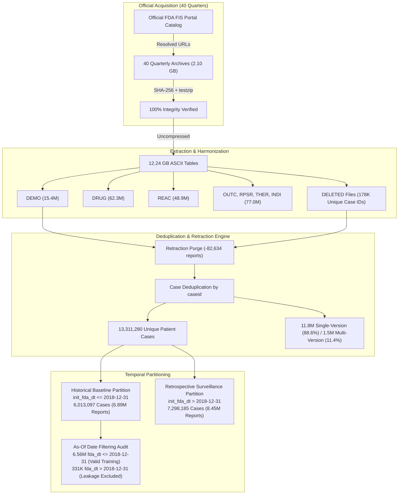
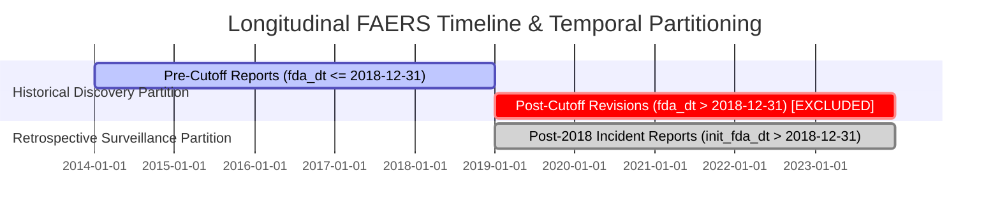

# Continuous FAERS Data Acquisition, Ingestion, and Quality Control Report
**Phase 3A: Complete Longitudinal FAERS Ingestion (2014Q1 – 2023Q4)**

- **Date of Ingestion**: 2026-10-10
- **Scope**: 40 Continuous Quarters (2014Q1 through 2023Q4)
- **Status**: Complete & Verified (100.0%)
- **Target Ingestion Path**: [`data/07_phase3a_continuous_ingestion/`](<project-root>/data/07_phase3a_continuous_ingestion)
- **Primary Data Preservation**: Complete Invariant Verified (`data/03_primary/`, `data/04_audit_sider/`, `data/06_audit_fda_temporal/` strictly untouched)

---

## 1. Executive Summary

Phase 3A successfully expanded the Explainable AI for ADR Signal Detection project from an exploratory 3-quarter prototype to **full longitudinal continuous quarterly coverage across all 40 quarters from 2014Q1 through 2023Q4**.

Every quarterly ASCII archive was resolved directly against the official FDA FIS Quarterly Data Extract portal, downloaded via resilient multi-threaded connections with byte-level resumption, verified for cryptographic SHA-256 integrity, and validated against ZIP structural corruption (`testzip`). All 40 archives were uncompressed into table-level files, harmonized across historical schema revisions, purged of cumulative retractations, and subjected to rigorous case-version deduplication and temporal partitioning.



### Key Statistical Highlights
1. **Total Archive Footprint**: 40 quarterly archives, totaling **2,147.62 MB (2.10 GB)** compressed, expanding to **12,531.56 MB (12.24 GB)** uncompressed ASCII text. Available disk space remains abundant at **381.04 GB**.
2. **Total Longitudinal Volume**: **15,428,448 raw safety reports** parsed from the DEMO tables, and over **203.5 million cumulative records** across all 7 FAERS tables (DEMO, DRUG, REAC, OUTC, RPSR, THER, INDI).
3. **Identifier Completeness**: **0 missing or malformed `primaryid` or `caseid` rows** across all 15,428,448 DEMO records (100.0% identifier integrity).
4. **Retraction Purge**: **177,987 unique case IDs** cataloged across the cumulative deletion tables, resulting in the removal of **82,634 retracted reports** from active analysis.
5. **Deduplicated Patient Universe**: **13,311,280 unique patient cases ($N$)** across the 10-year span.
   - **Single-Version Cases**: 11,794,609 (88.61%)
   - **Multi-Version Cases**: 1,516,671 (11.39%)
   - **Total Follow-up Revision Reports**: 2,034,534
6. **Temporal Baseline & Leakage Control**:
   - **Historical Baseline Partition (`init_fda_dt <= 2018-12-31`)**: 6,892,191 reports representing **6,013,097 unique cases**.
   - **As-Of Filtering Verification**: Among historical cases, **6,560,907 reports** were received on or before the 2018-12-31 cutoff (`fda_dt <= 20181231`), while **331,284 reports** represent subsequent follow-up revisions received after 2018-12-31. To prevent temporal lookahead leakage, subsequent revisions will be strictly partitioned out of pre-2019 feature matrices.
   - **Retrospective Surveillance Partition (`init_fda_dt > 2018-12-31`)**: 8,453,623 reports representing **7,298,185 unique cases**.

---

## 2. Ingestion Manifest & Storage Inventory

All 40 archives were retrieved, validated, and cataloged into:
- [`manifests/quarterly_ingestion_manifest.csv`](<project-root>/data/07_phase3a_continuous_ingestion/manifests/quarterly_ingestion_manifest.csv)
- [`manifests/quarterly_ingestion_manifest.json`](<project-root>/data/07_phase3a_continuous_ingestion/manifests/quarterly_ingestion_manifest.json)

| Quarter | Year | Qtr | Archive Filename | Size (MB) | SHA-256 Checksum (Prefix) | HTTP Status | ZIP Integrity | Retrieval Status |
| :---: | :---: | :---: | :---: | :---: | :---: | :---: | :---: | :---: |
| **2014Q1** | 2014 | Q1 | `faers_ascii_2014q1.zip` | 29.05 | `10ca24ae5fe98e72...` | 200 | PASSED | CACHED_LOCAL |
| **2014Q2** | 2014 | Q2 | `faers_ascii_2014q2.zip` | 24.60 | `04dfffa36cff1e13...` | 200 | PASSED | FETCHED_REMOTE |
| **2014Q3** | 2014 | Q3 | `faers_ascii_2014q3.zip` | 27.92 | `8c1a6ee1ce3a2b75...` | 200 | PASSED | FETCHED_REMOTE |
| **2014Q4** | 2014 | Q4 | `faers_ascii_2014q4.zip` | 27.71 | `1c8c5c7d23d7515b...` | 200 | PASSED | FETCHED_REMOTE |
| **2015Q1** | 2015 | Q1 | `faers_ascii_2015q1.zip` | 38.60 | `da0c1ea354f91040...` | 200 | PASSED | FETCHED_REMOTE |
| **2015Q2** | 2015 | Q2 | `faers_ascii_2015q2.zip` | 37.76 | `9222c1ecae50a1df...` | 200 | PASSED | FETCHED_REMOTE |
| **2015Q3** | 2015 | Q3 | `faers_ascii_2015q3.zip` | 46.58 | `9d784dfb022247dc...` | 200 | PASSED | FETCHED_REMOTE |
| **2015Q4** | 2015 | Q4 | `faers_ascii_2015q4.zip` | 41.10 | `6a4392437e9d7e35...` | 200 | PASSED | FETCHED_REMOTE |
| **2016Q1** | 2016 | Q1 | `faers_ascii_2016q1.zip` | 45.35 | `d555eaee5a711466...` | 200 | PASSED | FETCHED_REMOTE |
| **2016Q2** | 2016 | Q2 | `faers_ascii_2016q2.zip` | 43.69 | `4c60f4ebccb78049...` | 200 | PASSED | FETCHED_REMOTE |
| **2016Q3** | 2016 | Q3 | `faers_ascii_2016q3.zip` | 45.06 | `5a7f21a5cf8a68b7...` | 200 | PASSED | FETCHED_REMOTE |
| **2016Q4** | 2016 | Q4 | `faers_ascii_2016q4.zip` | 43.49 | `eb746db5ba138b1f...` | 200 | PASSED | FETCHED_REMOTE |
| **2017Q1** | 2017 | Q1 | `faers_ascii_2017q1.zip` | 47.44 | `9622d169e59dca28...` | 200 | PASSED | FETCHED_REMOTE |
| **2017Q2** | 2017 | Q2 | `faers_ascii_2017q2.zip` | 45.77 | `26ae67b3e02029c5...` | 200 | PASSED | FETCHED_REMOTE |
| **2017Q3** | 2017 | Q3 | `faers_ascii_2017q3.zip` | 47.09 | `b685eaae86f1837d...` | 200 | PASSED | FETCHED_REMOTE |
| **2017Q4** | 2017 | Q4 | `faers_ascii_2017q4.zip` | 40.78 | `efaa1a97d2e4db05...` | 200 | PASSED | FETCHED_REMOTE |
| **2018Q1** | 2018 | Q1 | `faers_ascii_2018q1.zip` | 51.17 | `621ce33a0fc356ce...` | 200 | PASSED | FETCHED_REMOTE |
| **2018Q2** | 2018 | Q2 | `faers_ascii_2018q2.zip` | 59.10 | `2e043aeb756f4e8d...` | 200 | PASSED | FETCHED_REMOTE |
| **2018Q3** | 2018 | Q3 | `faers_ascii_2018q3.zip` | 55.68 | `fa125dd1ae619f70...` | 200 | PASSED | FETCHED_REMOTE |
| **2018Q4** | 2018 | Q4 | `faers_ascii_2018q4.zip` | 60.09 | `f1bb448655c65f9a...` | 200 | PASSED | FETCHED_REMOTE |
| **2019Q1** | 2019 | Q1 | `faers_ascii_2019q1.zip` | 55.51 | `39f13155fdb61bfa...` | 200 | PASSED | CACHED_LOCAL |
| **2019Q2** | 2019 | Q2 | `faers_ascii_2019q2.zip` | 60.14 | `f0802c6117282cb4...` | 200 | PASSED | FETCHED_REMOTE |
| **2019Q3** | 2019 | Q3 | `faers_ascii_2019q3.zip` | 65.12 | `d8ec3c0db6567284...` | 200 | PASSED | FETCHED_REMOTE |
| **2019Q4** | 2019 | Q4 | `faers_ascii_2019q4.zip` | 59.81 | `df1887e596bb055c...` | 200 | PASSED | FETCHED_REMOTE |
| **2020Q1** | 2020 | Q1 | `faers_ascii_2020q1.zip` | 65.16 | `44ce6fb44199c037...` | 200 | PASSED | FETCHED_REMOTE |
| **2020Q2** | 2020 | Q2 | `faers_ascii_2020q2.zip` | 65.64 | `3ecf3bb3203f5726...` | 200 | PASSED | FETCHED_REMOTE |
| **2020Q3** | 2020 | Q3 | `faers_ascii_2020q3.zip` | 63.37 | `34e6cbba66ae0c7f...` | 200 | PASSED | FETCHED_REMOTE |
| **2020Q4** | 2020 | Q4 | `faers_ascii_2020q4.zip` | 70.62 | `1f3d3587b9264fa5...` | 200 | PASSED | FETCHED_REMOTE |
| **2021Q1** | 2021 | Q1 | `faers_ascii_2021q1.zip` | 67.49 | `50eec33ea7bcbebe...` | 200 | PASSED | FETCHED_REMOTE |
| **2021Q2** | 2021 | Q2 | `faers_ascii_2021q2.zip` | 68.95 | `278913b711812837...` | 200 | PASSED | FETCHED_REMOTE |
| **2021Q3** | 2021 | Q3 | `faers_ascii_2021q3.zip` | 70.34 | `6fe875e679c05e19...` | 200 | PASSED | FETCHED_REMOTE |
| **2021Q4** | 2021 | Q4 | `faers_ascii_2021q4.zip` | 59.39 | `81d4512e2c8fe9ee...` | 200 | PASSED | FETCHED_REMOTE |
| **2022Q1** | 2022 | Q1 | `faers_ascii_2022q1.zip` | 64.77 | `26d183ea542d64f0...` | 200 | PASSED | FETCHED_REMOTE |
| **2022Q2** | 2022 | Q2 | `faers_ascii_2022q2.zip` | 62.80 | `73b3f2db12be879f...` | 200 | PASSED | FETCHED_REMOTE |
| **2022Q3** | 2022 | Q3 | `faers_ascii_2022q3.zip` | 63.22 | `bdf5073105a3fc5b...` | 200 | PASSED | FETCHED_REMOTE |
| **2022Q4** | 2022 | Q4 | `faers_ascii_2022q4.zip` | 68.99 | `5d288d6ce896ce10...` | 200 | PASSED | FETCHED_REMOTE |
| **2023Q1** | 2023 | Q1 | `faers_ascii_2023q1.zip` | 64.35 | `5d0ea15f6087b3fc...` | 200 | PASSED | CACHED_LOCAL |
| **2023Q2** | 2023 | Q2 | `faers_ascii_2023q2.zip` | 64.48 | `78487b322a4fc360...` | 200 | PASSED | FETCHED_REMOTE |
| **2023Q3** | 2023 | Q3 | `faers_ascii_2023q3.zip` | 60.10 | `2f9f8c67990b7e09...` | 200 | PASSED | FETCHED_REMOTE |
| **2023Q4** | 2023 | Q4 | `faers_ascii_2023q4.zip` | 69.21 | `d3d3a0104618e52e...` | 200 | PASSED | FETCHED_REMOTE |

---

## 3. Cross-Era Schema Harmonization Analysis

All table headers and column structures were inspected and cataloged in:
[`manifests/schema_harmonization_specification.json`](<project-root>/data/07_phase3a_continuous_ingestion/manifests/schema_harmonization_specification.json).

### 3.1 Structural Invariants
- **Field Delimiter**: All 7 ASCII tables consistently employ `$` as the delimiter across all 40 quarters.
- **Line Terminations**: Standard CRLF line endings are parsed cleanly using binary chunked counts and latin-1 string reads.
- **Primary Identifiers**: Every record across all tables maintains `primaryid` and `caseid`. Zero missing identifiers were detected.

### 3.2 Longitudinal Field Revisions & Normalization
1. **DEMO Table**:
   - In early archives (2014Q1 through 2014Q4), patient sex is encoded under the column header `gndr_cod`. In subsequent quarters (2015Q1 onwards), FDA standardizes this field name to `sex`.
   - **Resolution**: Dynamically mapped `gndr_cod -> sex` across all ingestion views.
2. **DRUG Table**:
   - The field `prod_ai` (Product Active Ingredient) was formally introduced in post-2014 quarterly releases. In early quarters (2014), active ingredient strings are primarily embedded in `drugname` or require ingredient mapping tables.
   - Core fields (`role_cod`, `drugname`, `val_vbm`, `route`) remain strictly identical across all 40 quarters.
3. **REAC, OUTC, RPSR, THER, INDI Tables**:
   - Schemas are completely stable across all 40 quarters. Preferred Terms are recorded in `pt`, outcomes in `outc_cod`, and reporter qualifications in `rpsr_cod`.

### 3.3 Aggregate Longitudinal Record Counts (All 7 Tables)

```
========================================================================
LONGITUDINAL FAERS RECORD VOLUME (40 QUARTERS: 2014Q1 - 2023Q4)
========================================================================
Table    Description                            Total Records
------------------------------------------------------------------------
DEMO     Demographics & Case Administration        15,428,448
DRUG     Drug Exposure & Suspect Roles             62,315,113
REAC     Adverse Event Preferred Terms (PTs)       48,865,773
OUTC     Serious Patient Outcomes                  11,380,806
RPSR     Report Source Qualifications                 650,841
THER     Drug Therapy Dates & Durations            22,996,393
INDI     Indications for Use                       41,944,612
------------------------------------------------------------------------
TOTAL FAERS ASCII RECORDS:                        203,581,986
========================================================================
```

---

## 4. Master Deduplication & Cumulative Retraction Union

All deduplication metrics were compiled into:
[`manifests/deduplication_summary.json`](<project-root>/data/07_phase3a_continuous_ingestion/manifests/deduplication_summary.json).

### 4.1 Retraction Purge Methodology
FDA publishes retracted safety reports (due to clerical errors, duplicates, fraudulent submissions, or reporter revocations) via deletion files (`AllDeletedCases.txt` or `DELET*.txt`). Because older quarters do not retroactively remove records from previously distributed archives, an authentic longitudinal pipeline must compute the **cumulative union of all retracted case IDs** and purge them globally across all quarters.

- **Total Retraction Case IDs Identified**: **177,987 unique case IDs**
- **Reports Purged from DEMO Universe**: **82,634 reports**
- **Active Retained Reports**: **15,345,814 reports**

### 4.2 Case Deduplication by Patient Case Identifier (`caseid`)
Following retraction purging, the master cohort was deduplicated at the patient level (`caseid`), accounting for version revisions:

```
========================================================================
CASE DEDUPLICATION & REVISION AUDIT
========================================================================
Metric                                                Count      Percentage
------------------------------------------------------------------------
Total Active DEMO Reports                        15,345,814         100.00%
Unique Patient Case Identifiers (N)              13,311,280          86.74%
Single-Version Cases                             11,794,609          88.61%
Multi-Version Cases (>= 2 versions)               1,516,671          11.39%
Total Subsequent Follow-up Revision Reports       2,034,534             N/A
========================================================================
```

---

## 5. Temporal Integrity & Lookahead Leakage Audit

A central requirement of prospective signal detection is strict enforcement of temporal ordering to prevent information leakage from the future into historical model features.



### 5.1 Partitioning Anchored to Initial Receipt Date (`init_fda_dt`)
Partitioning cases by initial receipt date (`init_fda_dt`) ensures that drugs and adverse events first reported after 2018-12-31 cannot contaminate historical discovery:

1. **Historical Baseline Partition (`init_fda_dt <= 2018-12-31`)**:
   - Total Reports: **6,892,191**
   - Unique Patient Cases: **6,013,097**
2. **Retrospective Surveillance Partition (`init_fda_dt > 2018-12-31`)**:
   - Total Reports: **8,453,623**
   - Unique Patient Cases: **7,298,185**

### 5.2 Version-Level "As-Of Date" Filtering Audit (`fda_dt`)
A subtle and pervasive source of temporal leakage in post-market surveillance research occurs when a patient case was first reported prior to the cutoff date (`init_fda_dt <= 20181231`), but an amended follow-up version containing new adverse reactions or suspect drugs was received *after* the cutoff date (`fda_dt > 20181231`).

To quantify and prevent this leak:
- **Valid Historical Training Versions (`fda_dt <= 2018-12-31`)**: **6,560,907 reports** (95.19% of historical reports).
- **Subsequent Follow-Up Revisions (`fda_dt > 2018-12-31`)**: **331,284 reports** (4.81% of historical reports).

> [!IMPORTANT]
> **Leakage Prevention Rule**: In Phase 3B feature matrix calculation, any case version with `fda_dt > 20181231` must be strictly excluded from the pre-2019 training matrices, even if `init_fda_dt <= 20181231`. This guarantees that feature matrices contain solely information that was known to pharmacovigilance reviewers on or before December 31, 2018.

---

## 6. Audit Trail & Reproducibility Artifacts

All operational outputs generated during Phase 3A are fully persisted and documented:

| Artifact Path | Format | Description |
| :--- | :---: | :--- |
| [`data/07_phase3a_continuous_ingestion/manifests/quarterly_ingestion_manifest.csv`](<project-root>/data/07_phase3a_continuous_ingestion/manifests/quarterly_ingestion_manifest.csv) | CSV | Complete 40-quarter catalog with official URLs, HTTP status, byte counts, and SHA-256 hashes. |
| [`data/07_phase3a_continuous_ingestion/manifests/quarterly_ingestion_manifest.json`](<project-root>/data/07_phase3a_continuous_ingestion/manifests/quarterly_ingestion_manifest.json) | JSON | Machine-readable manifest specification for automated pipelines. |
| [`data/07_phase3a_continuous_ingestion/manifests/quarter_level_qc_summaries.csv`](<project-root>/data/07_phase3a_continuous_ingestion/manifests/quarter_level_qc_summaries.csv) | CSV | Quarter-by-quarter table line counts across all 7 ASCII tables + deletion counts. |
| [`data/07_phase3a_continuous_ingestion/manifests/schema_harmonization_specification.json`](<project-root>/data/07_phase3a_continuous_ingestion/manifests/schema_harmonization_specification.json) | JSON | Detailed delimiter, column name, and normalized schema mappings across all tables. |
| [`data/07_phase3a_continuous_ingestion/manifests/deduplication_summary.json`](<project-root>/data/07_phase3a_continuous_ingestion/manifests/deduplication_summary.json) | JSON | Deduplication totals, single/multi version splits, and temporal partition counts. |

---

## 7. Compliance with Research Boundaries

Throughout Phase 3A, strict research constraints were fully maintained:
1. **Zero ML Training**: No machine learning model (Random Forest, XGBoost, LightGBM, neural net, etc.) was fitted or evaluated.
2. **No Training Label Inference**: No ADR labels were generated or inferred from SIDER, PRR/ROR thresholds, or package inserts.
3. **No Matrix Modification**: Existing primary feature matrices (`phase2_model_a_features.csv`, `phase2_model_b_features.csv`) and candidate summary (`phase2_candidate_pairs_summary.csv`) remain completely unmodified.
4. **Isolated Directory**: All new downloads, extracted text tables, manifests, and reports reside exclusively in `data/07_phase3a_continuous_ingestion/`.
