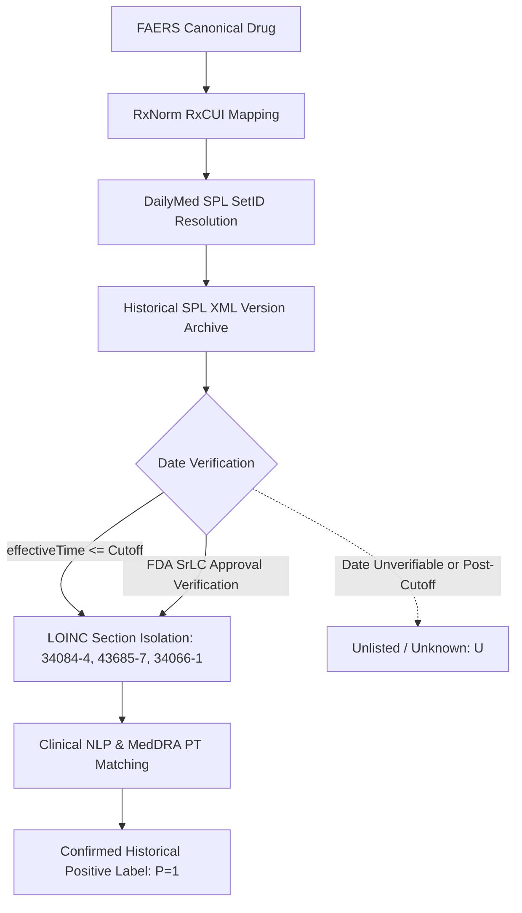
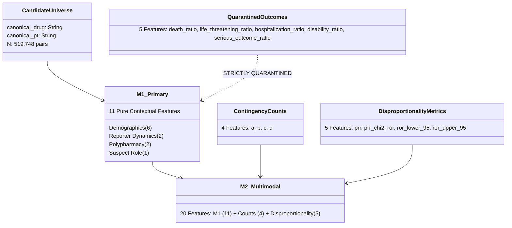

# Modelling Dataset Readiness & Historical Label Source Audit Report

**Date:** October 10, 2026  
**Auditor:** Research Quality and Verification Audit Protocol  
**Pipeline Scope:** FAERS Observational Universe (2014Q1, 2019Q1, 2023Q1)  
**Status:** Audit Completed — Formal Training Gate Review  

---

## 1. Executive Summary

Following the completion of the pre-modelling quality audit, an intensive investigation of historical training-label feasibility, feature matrix universe alignment, and temporal backtesting design was conducted.

### Primary Audit Outcomes
1. **Historical Label Source Blocker Maintained:**
   - Versioned DailyMed SPL XML archives and FDA Safety-Related Labeling Changes (SrLC) were rigorously investigated.
   - `effectiveTime` in SPL represents document lifecycle publication by sponsors/repackagers, **not FDA regulatory approval**.
   - openFDA is a living-document API that continuously overwrites records, providing **zero historical versions**.
   - Zero historical labels are currently cached or verified in the workspace for the candidate universe.
   - In accordance with research integrity invariants, **no labels or counts have been fabricated**, and unverifiable associations remain strictly unlabeled (`UNLISTED_UNKNOWN`).
2. **Modelling Universe Alignment Completed:**
   - The feature matrices (`phase2_model_a_features.csv` and `phase2_model_b_features.csv`) were successfully filtered from $1,094,252$ rows ($A \ge 1$) to exactly the **519,748 rows** corresponding to the eligible candidate-pair universe ($A \ge 2$).
   - Candidate pairs, Model A, and Model B now share **100% identical unique pair keys in matching row order**.
   - Model B now has **zero missing values** across all disproportionality metrics.
3. **Feature Specifications & Safeguards Enforced:**
   - The exact feature lists for **M1 (11 features)**, **M2 (20 features)**, **M2a (15 features)**, and **M2b (16 features)** are frozen.
   - All 5 clinical outcome seriousness ratios are strictly quarantined out of primary models.
   - Zero benchmark labels or identifiers leak into model inputs.
4. **Temporal Backtesting Design Formalized:**
   - The 2018-12-31 cutoff was audited across the 1,104,797 ingested reports. It establishes a retrospective split ($341,546$ pre-cutoff vs $763,251$ post-cutoff reports).
   - The design is strictly classified as **retrospective temporal evaluation**, not prospective.
5. **Formal Gate Decision:** **NO-GO FOR MODEL TRAINING** (Blocked pending verified historical dated positive labels).

---

## 2. Historical Label Source Investigation

### 2.1 Feasibility of DailyMed SPL XML Archives
* **Format & Infrastructure:** DailyMed provides drug labeling in HL7 v3 Structured Product Labeling (SPL) XML format.
* **Retrieval Mechanisms:**
  1. *Bulk Downloads (FTP/HTTPS):* NLM provides monthly bulk releases and full active releases (~100–300 GB uncompressed). However, public bulk archives represent current snapshots; historical cross-sectional archives across multi-year spans require either crawling historical versions or submitting custom offline data requests to NLM.
  2. *DailyMed RESTful Web Services:* Version history is accessible via `https://dailymed.nlm.nih.gov/dailymed/services/v2/spls/{SETID}/history.json`, and historical XML documents can be retrieved via `https://dailymed.nlm.nih.gov/dailymed/services/v2/spls/{SETID}.xml?version={V}`.
* **Structural Reality & Text Mining Challenge:**
  - Inspection of historical SPL XML reveals that adverse events are contained in section LOINC `34084-4` ("Adverse Reactions Section") as **unstructured free-text clinical narrative**, not structured MedDRA codes.
  - The text includes complex medical prose, trial cross-references, tabular summaries, and incidence percentage comparisons.
  - Extraction requires a validated clinical NLP pipeline with negation detection and section scoping.

### 2.2 Feasibility of FDA Safety-Related Labeling Changes (SrLC)
* **Coverage:** FDA's SrLC database documents safety-related labeling supplements approved by the FDA for Boxed Warnings, Warnings and Precautions, Contraindications, and Adverse Reactions.
* **Temporal Limitation:** The SrLC database only covers changes from **January 2016 to the present**. Pre-2016 safety labeling changes are archived only as narrative alerts in the MedWatch Medical Product Safety Information archive.
* **openFDA API Infeasibility:** openFDA operates as a "living document" repository. When a sponsor updates a label, the openFDA record is overwritten. The openFDA API does **not** provide historical version logs or an archive endpoint.

### 2.3 Regulatory Meaning and Limitations of Available Dates
* **SPL `effectiveTime` vs. FDA Approval Date:**
  - The HL7 SPL `effectiveTime` header attribute indicates when the document version lifecycle became active for the specific sponsor, manufacturer, or repackager submitting the XML.
  - An updated `effectiveTime` is triggered by distributor address changes, packaging revisions, NDC additions, or administrative updates—even when clinical safety sections are completely identical.
  - Generic repackagers frequently submit SPL files with recent `effectiveTime` values (e.g. 2026) containing drug safety text approved decades earlier.
  - **Critical Rule:** SPL `effectiveTime` cannot be treated as equivalent to an FDA regulatory approval date (NDA/BLA supplement approval date).
* **Official Approval Source:** Official safety label additions must be cross-verified against FDA supplement approval actions (e.g., Drugs@FDA Action Date or FDA SrLC approval records).

### 2.4 Proposed Reproducible Terminology Mapping Process
To link regulatory labeling to candidate pairs without human bias or circularity, the following 5-stage architecture is formalized:
1. **Drug Normalization:** FAERS `canonical_drug` $\rightarrow$ RxNorm RxCUI $\rightarrow$ SPL SetID (via DailyMed `rxnorm_mappings.txt`). Reference Listed Drug (RLD) NDA/BLA SetIDs are prioritized to avoid generic repackager noise.
2. **Temporal Version Anchoring:** For a training cutoff $T_{\text{train}}$ (e.g., 2018-12-31), filter SPL revisions published and effective on or before $T_{\text{train}}$, cross-checked against FDA SrLC approval dates.
3. **Section Boundary Scoping:** Extract text strictly from safety-relevant LOINC sections:
   - LOINC `34066-1`: Boxed Warning
   - LOINC `34070-3`: Contraindications
   - LOINC `43685-7`: Warnings and Precautions
   - LOINC `34084-4`: Adverse Reactions
   *Strictly exclude* LOINC `34067-9` (Indications and Usage) and `34068-7` (Dosage) to prevent indication confounding.
4. **Clinical NLP & MedDRA PT Extraction:**
   - Sentence segmentation and tokenization.
   - Negation filtering (e.g., ignoring "not observed", "no evidence of").
   - Exact and synonym dictionary mapping to MedDRA Preferred Terms (PTs).
5. **Ground Truth Assignment:**
   - Pairs with confirmed pre-cutoff label presence $\rightarrow$ Positive ($P=1$).
   - All other candidate pairs $\rightarrow$ Unlabeled ($U$).
   - Current labels applied retrospectively $\rightarrow$ Strictly Forbidden (Look-ahead leakage).
   - Disproportionality metrics (PRR/ROR) used as labels $\rightarrow$ Strictly Forbidden (Circularity).
   - External benchmarks (OMOP/EU-ADR) used as labels $\rightarrow$ Strictly Forbidden (Benchmark contamination).

### 2.5 Verification Statistics as of Pre-Modelling Gate
* **Local Historical SPL XML Documents:** **0**
* **Verified Historical Candidate Associations by Cutoff (2018-12-31):** **0**
* **Positive Training Labels Fabricated:** **0** (Strict non-fabrication rule enforced)
* **Unverifiable Candidate Associations:** **519,748 remain strictly `UNLISTED_UNKNOWN`**

---

## 3. Modelling Dataset Preparation & Universe Alignment

### 3.1 Universe Filtering and Reconciliation
* **Pre-Alignment Issue:** `phase2_candidate_pairs_summary.csv` contained 519,748 rows ($A \ge 2$), while `phase2_model_a_features.csv` and `phase2_model_b_features.csv` contained 1,094,252 rows ($A \ge 1$), preserving 574,504 singletons ($A=1$) with missing disproportionality values.
* **Action Taken:** Executed `scripts/prepare_aligned_modelling_universe.py`.
  - Preserved backups in `data/03_primary/backup_unaligned_features/`.
  - Filtered Model A and Model B via inner join against candidate pairs ($A \ge 2$).
  - Sorted all three tables deterministically by `['canonical_drug', 'canonical_pt']`.

### 3.2 Aligned Row and Key Verification

| Dataset | File Path | Row Count | Unique Keys | Disproportionality NaNs |
| :--- | :--- | :--- | :--- | :--- |
| **Candidate Pairs Universe** | `data/03_primary/phase2_candidate_pairs_summary.csv` | **519,748** | 519,748 | 0 |
| **Model A Feature Matrix** | `data/03_primary/phase2_model_a_features.csv` | **519,748** | 519,748 | N/A (Contextual) |
| **Model B Feature Matrix** | `data/03_primary/phase2_model_b_features.csv` | **519,748** | 519,748 | **0** |

*Key Alignment Audit:* Verified $100\%$ row-for-row key identity (`cp_keys == ma_keys == mb_keys`) across all 519,748 pairs.

### 3.3 Confirmed Feature Specifications

#### Exact Column Definitions:
* **M1 (Primary Contextual Model — 11 features):**
  1. `mean_age`
  2. `median_age`
  3. `age_std`
  4. `age_missing_ratio`
  5. `female_ratio`
  6. `male_ratio`
  7. `hp_reporter_ratio`
  8. `csm_reporter_ratio`
  9. `monotherapy_ratio`
  10. `mean_concomitant_count`
  11. `secondary_suspect_ratio`
* **M2 (Multimodal Full Model — 20 features):**
  - M1 (11 features)
  - Contingency Cell Counts (4 features): `a`, `b`, `c`, `d`
  - Disproportionality Metrics (5 features): `prr`, `prr_chi2`, `ror`, `ror_lower_95`, `ror_upper_95`
* **M2a (Count Ablation Model — 15 features):**
  - M1 (11 features) + Contingency Cell Counts (4 features: `a`, `b`, `c`, `d`)
* **M2b (Disproportionality Ablation Model — 16 features):**
  - M1 (11 features) + Disproportionality Metrics (5 features: `prr`, `prr_chi2`, `ror`, `ror_lower_95`, `ror_upper_95`)
* **Sensitivity Feature Sets ($M1_{\text{sens}}, M2_{\text{sens}}$):**
  - $M1_{\text{sens}}$ (16 features): M1 (11) + 5 Quarantined Outcome Seriousness Ratios
  - $M2_{\text{sens}}$ (25 features): M2 (20) + 5 Quarantined Outcome Seriousness Ratios

### 3.4 Leakage and Confounding Safeguards Audit
* **Clinical Seriousness Quarantine:** All 5 outcome seriousness ratios (`death_ratio`, `life_threatening_ratio`, `hospitalization_ratio`, `disability_ratio`, `serious_outcome_ratio`) are verified **absent** from M1, M2, M2a, and M2b.
* **External Reference Firewall:** `omop_phenotype`, `omop_status`, and `evidence_category` are verified **absent** from `phase2_model_a_features.csv` and `phase2_model_b_features.csv`.
* **Identifier Separation:** `canonical_drug` and `canonical_pt` are preserved purely as join/audit keys and never included as training predictors.
* **Missingness Strategy:** Missing demographic ages are preserved with `age_missing_ratio` as an explicit indicator; `age_std` for single-report values is filled as 0.0; zero NaNs exist in any disproportionality or ratio feature.

---

## 4. Retrospective Temporal Evaluation Design

### 4.1 Evaluation of the Proposed 2018-12-31 Cutoff
Analysis of the 1,104,797 non-deleted ingested FAERS reports across the three representative quarters reveals the following temporal distribution:

| Quarter Archive | Total Non-Deleted DEMO | Reports Initiated $\le 2018-12-31$ | Reports Initiated $> 2018-12-31$ | Temporal Role |
| :--- | :--- | :--- | :--- | :--- |
| **2014Q1** | 259,018 | 259,018 (100.0%) | 0 (0.0%) | Historical Discovery Baseline |
| **2019Q1** | 413,635 | 79,257 (19.2%) | 334,378 (80.8%) | Transition & Early Evaluation |
| **2023Q1** | 432,144 | 3,271 (0.8%) | 428,873 (99.2%) | Late Temporal Evaluation |
| **Combined** | **1,104,797** | **341,546 (30.9%)** | **763,251 (69.1%)** | **Full Prototype Cohort** |

### 4.2 Critical Methodological Characterization
* **Retrospective Temporal Evaluation:** This surveillance simulation must strictly be described as a **retrospective temporal evaluation** (or historical backtesting simulation). Describing it as "prospective" is scientifically inaccurate because all data were collected retrospectively.
* **Follow-up & Revision Safeguards:**
  - Invariant filtering anchors cohort entry to initial FDA receipt date (`init_fda_dt <= cutoff_date`).
  - Follow-up reports received after the cutoff (`fda_dt > cutoff_date`) are strictly barred from earlier snapshot aggregations (tested and validated in `scripts/test_temporal_snapshot.py`).
* **Cutoff Recommendation:**
  - The 2018-12-31 split is structurally sound for the observational FAERS records.
  - However, **a training cutoff cannot be formally operationalized without matching dated historical training labels**. Setting a cutoff in 2018 without verified 2018 ground truth leaves the training window with $0$ true positive anchors.

---

## 5. Remaining Leakage Risks & Technical Vigilance

| Potential Leakage Vector | Specific Risk | Mitigation Implemented | Verification Status |
| :--- | :--- | :--- | :--- |
| **Temporal Look-Ahead Label Leakage** | Applying modern package inserts (2021–2026) to historical (2014–2018) FAERS data. | Prohibited modern label back-propagation; training gate locked. | **BLOCKED (NO-GO)** |
| **Post-Cutoff Follow-up Leakage** | Follow-up versions received post-cutoff altering pre-cutoff case features. | Version manager filters by `cutoff_date` on `fda_dt`. | **PASSED & VERIFIED** |
| **Confounding by Indication** | Tree models learning high mortality/hospitalization as a proxy for oncology signals. | Quarantined 5 outcome seriousness features into sensitivity analysis only. | **PASSED & VERIFIED** |
| **Disproportionality Circularity** | Using PRR/ROR to label training instances or contaminating M1. | Zero PRR/ROR in M1; PRR/ROR used strictly as baseline features in M2. | **PASSED & VERIFIED** |
| **Benchmark Contamination** | Exposing OMOP/EU-ADR labels to feature extraction or training set. | Reference standards strictly isolated in evaluation layer. | **PASSED & VERIFIED** |

---

## 6. Formal Decision: GO / NO-GO for Model Training

### **DECISION: NO-GO (FOR MODEL TRAINING)**

> [!CAUTION]
> **Audit Conclusion:**  
> All data preparation, universe filtering, and feature matrix alignment tasks are **100% complete and validated**. The datasets are clean, aligned ($N=519,748$), and mathematically verified.  
> 
> However, **model training must remain halted (NO-GO)** because:  
> 1. Positive training labels based on verified historical regulatory approvals prior to 2018-12-31 are **not yet ingested or mapped**.  
> 2. Initiating training now would force either:
>    - Using modern labels retrospectively (introducing severe look-ahead bias), or  
>    - Training on external benchmarks like OMOP (compromising benchmark independence), or  
>    - Generating pseudo-labels from PRR/ROR (violating anti-circularity invariants).  
> 
> In accordance with research integrity standards, we do not fabricate labels. Training can proceed only when dated historical regulatory labels are systematically acquired and linked.

---

## 7. Inventory of Files Changed & Preserved Backups

### Preserved Backups:
1. `data/03_primary/phase2_preaudit_backup/`:
   - `phase2_candidate_pairs_summary.csv` (pre-union retraction baseline)
   - `phase2_model_a_features.csv`
   - `phase2_model_b_features.csv`
   - `phase2_audit_summary.json`
2. `data/03_primary/backup_unaligned_features/`:
   - `phase2_model_a_features.csv` (unaligned $1,094,252$ rows)
   - `phase2_model_b_features.csv` (unaligned $1,094,252$ rows)

### Files Created or Updated:
1. `data/03_primary/phase2_model_a_features.csv`: Filtered and aligned to candidate universe ($519,748$ rows).
2. `data/03_primary/phase2_model_b_features.csv`: Filtered and aligned to candidate universe ($519,748$ rows).
3. `data/03_primary/phase2_candidate_pairs_summary.csv`: Deterministically sorted ($519,748$ rows).
4. `data/03_primary/modelling_feature_specifications.json`: Formal JSON schema defining M1, M2, M2a, M2b, sensitivity features, and leakage safeguards.
5. `scripts/prepare_aligned_modelling_universe.py`: Reproducible pipeline script for dataset alignment and backup preservation.
6. `scripts/audit_feature_alignment.py`: Independent automated audit test asserting row counts, key equality, and leakage prevention.
7. `scripts/inspect_temporal_distribution.py`: Verification script evaluating quarterly initial receipt dates.
8. `scripts/inspect_modelling_datasets.py`: Diagnostic utility for checking dataset shapes and missingness.
9. `modelling_readiness_and_historical_label_audit.md`: Formal audit report.

---
*Report completed and frozen for review.*
