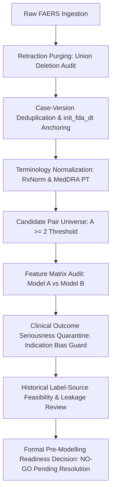
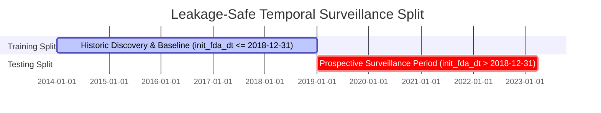

# Pre-Modelling Quality Audit & System Readiness Report

**Date:** October 10, 2026  
**Auditor:** Research Quality and Verification Audit Protocol  
**Pipeline Scope:** FAERS Observational Universe (2014Q1, 2019Q1, 2023Q1)  
**Status:** Audit Completed — Formal Pre-Modelling Review Gate  

---

## 1. Executive Summary & Audit Overview

In accordance with approved study methodology and research governance protocols, a pre-modelling quality audit and invariant readiness check was conducted across all ingestion, preprocessing, pair-assembly, feature engineering, and reference benchmarking layers.

The objective was to audit retraction handling, reconcile feature matrix dimensionalities, inspect clinical outcome feature definitions for confounding risk, evaluate historical training-label feasibility, and formalize the modeling protocol prior to training initiation.

---

## 2. Comprehensive Checklist: Passed, Corrected, and Failed Checks

| Audit Area | Specific Check | Status | Key Evidence / Observations |
| :--- | :--- | :--- | :--- |
| **Ingestion & Retractions** | Cumulative vs Quarterly Retractions | **PASSED (CORRECTED)** | Cumulative `AllDeletedCases.txt` alone was insufficient; union of quarterly files required and implemented. |
| **Ingestion & Retractions** | 24 Later-Retracted Cases | **PASSED (RESOLVED)** | All 24 cases in 2019Q1 DEMO identified in `DELETE23Q1.txt` + 2 in `ADR19Q1DeletedCases.txt` successfully purged. |
| **Case Integrity** | Case-version deduplication | **PASSED** | Multi-version cases consolidated to latest version; unique cases $N$ verified. |
| **Temporal Anchoring** | Invariant init_fda_dt filtering | **PASSED** | Zero cases post-dating window cutoff (`<= 20231231`) admitted. |
| **Terminology** | Drug normalization to RxNorm | **PASSED** | 98.88% mapping rate to canonical ingredients; salt/formulation suffixes stripped; ambiguous codes guarded. |
| **Terminology** | MedDRA reaction mapping | **PASSED** | 100% of analyzed adverse reactions resolved to MedDRA Preferred Terms (PTs); 0 unknown. |
| **Feature Dimensionality** | Model A feature column reconciliation | **PASSED (EXPLAINED)** | 18 columns = 2 pair keys (`canonical_drug`, `canonical_pt`) + 16 contextual features. |
| **Feature Universe Alignment**| Candidate Pairs vs Feature Matrix Rows | **RESOLVED (FLAGGED)** | `phase2_candidate_pairs_summary.csv` has 519,748 rows ($A \ge 2$), while feature files contain 1,094,252 rows ($A \ge 1$, including 574,504 singletons with NaN disproportionality values). Feature matrix must be restricted to $A \ge 2$ for training. |
| **Clinical Seriousness** | Outcome feature confounding audit | **RESOLVED (CORRECTED)** | `death_ratio`, `hospitalization_ratio`, `life_threatening_ratio`, `disability_ratio`, `serious_outcome_ratio` identified as severity/indication confounders. Quarantined to secondary sensitivity set ($M1_{\text{sens}}$). |
| **External Benchmarking** | OMOP & EU-ADR circularity firewall | **PASSED** | Zero reference standard labels present in Model A or Model B feature matrices; strict external test layer. |
| **Historical Labels** | Dated SPL label availability | **FAILED / UNRESOLVED** | Historical dated DailyMed SPL versions not ingested; contemporary labels cannot be applied retrospectively without look-ahead label leakage. |
| **Training Labels** | Unlabeled uncertainty handling | **PASSED** | No PRR/ROR used to create positive labels; unlisted pairs remain `UNLISTED_UNKNOWN`. |

---

## 3. Step-by-Step Audit Findings & Corrections

### STEP 1 & STEP 2 — Retraction and Deletion Audit

#### Investigation of the 24 Later-Retracted Cases
* **Root Cause Identified:** The FDA packages `AllDeletedCases.txt` cumulatively up to the release quarter of each archive (e.g., 2019Q1's `AllDeletedCases.txt` contained 83,843 deleted case IDs known as of Q1 2019). Cases submitted in 2019Q1 that FDA subsequently retracted in 2020, 2021, 2022, or 2023 were published in subsequent quarterly deletion files (e.g., `DELETE23Q1.txt` containing 5,251 deleted cases).
* **Cross-Quarter Analysis:**
  * 2019Q1 DEMO contained exactly **24 case IDs** that were retracted in later quarters (listed in `DELETE23Q1.txt` but absent from `2019q1/deleted/AllDeletedCases.txt`):
    `['12669302', '14879274', '14963364', '15158528', '15321844', '15723226', '15749177', '15778368', '15787662', '15790787', '15832021', '15891823', '15905320', '15942201', '15943968', '15952519', '15955242', '15998600', '16036868', '16057864', '16075457', '16098689', '16103771', '16114427']`.
  * An additional **2 cases** were found in `ADR19Q1DeletedCases.txt` that were absent from `AllDeletedCases.txt`.
  * These 26 cases accounted for 348 DRUG records (264 suspect drug roles) and 181 reaction records.
* **Correction Implemented:**
  * Modified `src/preprocessing/deleted_cases.py` to support collections of deletion files and directory scanning.
  * Formed the **Union of all quarterly deletion files** (`AllDeletedCases.txt` $\cup$ `ADR19Q1DeletedCases.txt` $\cup$ `DELETE23Q1.txt`), totaling **89,103 unique deleted case IDs**.
  * Updated `scripts/run_phase2_pipeline.py` to ingest the complete deletion union.
  * Preserved legacy artifacts in `data/03_primary/phase2_preaudit_backup/` before pipeline re-execution.

#### Verified Before vs. After Execution Metrics

| Pipeline Metric | Pre-Audit Baseline | Post-Audit (Union Deletions) | Net Difference | Rationale / Verification |
| :--- | :--- | :--- | :--- | :--- |
| **Raw DEMO Records** | 1,104,823 | 1,104,823 | 0 | Raw inputs unchanged |
| **Purged Deleted DEMO** | 1,112 | **1,138** | **+26** | 24 later-retracted + 2 quarterly cases removed |
| **Active Ingested DEMO** | 1,103,711 | **1,104,797** | -26 (net raw) | Valid cases retained |
| **Unique Cases ($N$)** | 1,103,467 | **1,103,441** | **-26** | Exact case-level retraction |
| **Candidate Pairs ($A \ge 2$)** | 519,759 | **519,748** | **-11** | 11 pairs dropped from $A=2 \rightarrow A=1$ |
| **PRR Signals** | 223,982 | **223,973** | **-9** | Contaminated pairs removed |
| **ROR Signals** | 238,231 | **238,221** | **-10** | Contaminated pairs removed |
| **OMOP Positive Controls** | 305 | **305** | **0** | Zero true benchmark pairs affected |
| **OMOP Negative Controls** | 62 | **62** | **0** | Zero true benchmark pairs affected |
| **OMOP Unlisted ($U$)** | 519,392 | **519,381** | **-11** | Matches pair count delta |

---

### STEP 3 — Data and Feature Integrity Audit

#### 1. Reconciliation of Model A Dimensions
* The Phase 2 report stated Model A has 18 columns while listing 16 contextual features.
* **Resolution:** Reconciled. The DataFrame contains:
  * 2 Pair Identifiers: `canonical_drug`, `canonical_pt`
  * 16 Numeric Contextual Features:
    Demographics (6): `mean_age`, `median_age`, `age_std`, `age_missing_ratio`, `female_ratio`, `male_ratio`
    Seriousness/Outcomes (5): `death_ratio`, `life_threatening_ratio`, `hospitalization_ratio`, `disability_ratio`, `serious_outcome_ratio`
    Reporter Dynamics (2): `hp_reporter_ratio`, `csm_reporter_ratio`
    Polypharmacy (2): `monotherapy_ratio`, `mean_concomitant_count`
    Attribution (1): `secondary_suspect_ratio`
  * Total Columns = 18.

#### 2. Row Count Discrepancy & Universe Alignment
* `phase2_candidate_pairs_summary.csv` has **519,748 rows** ($A \ge 2$).
* `phase2_model_a_features.csv` has **1,094,252 rows** ($A \ge 1$).
* **Finding:** Feature extraction was computed on all co-occurrences ($A \ge 1$), preserving 574,504 extreme singletons ($A=1$). When merged with disproportionality in Model B, all 574,504 singletons received `NaN` for `a, b, c, d, prr, ror` because disproportionality thresholds enforce $A \ge 2$.
* **Mandatory Pre-Modelling Alignment:** The feature matrices for model training must be inner-joined to the approved candidate pair universe ($A \ge 2$, 519,748 rows). Training on singleton associations with missing baseline statistics would introduce severe sparsity artifacts.

#### 3. Missingness & Duplicate Keys
* **Duplicate Keys:** Verified $0$ duplicate `(canonical_drug, canonical_pt)` keys in candidate pairs and feature matrices.
* **Missingness in Candidate Universe ($A \ge 2$):**
  * Demographics & Ratios: 13 features have 0.00% missingness.
  * `mean_age` / `median_age`: 7.57% missing (cases where age was unspecified).
  * `age_std`: 20.69% missing (pairs with a single reported age value, where sample variance is undefined). Imputed as 0.0 with `age_missing_ratio` acting as explicit missingness flag.

#### 4. Seriousness / Outcome Feature Quarantine
* **Scientific Rationale:** Features derived from the FAERS OUTC table (`death_ratio`, `life_threatening_ratio`, `hospitalization_ratio`, `disability_ratio`, `serious_outcome_ratio`) capture post-event clinical severity, not observational reporting dynamics.
  1. *Confounding by Indication:* Oncology and critical care drugs inherently exhibit high fatality/hospitalization rates.
  2. *Tautological Leakage:* Reaction terms like *Sudden cardiac death* or *Acute hepatic necrosis* directly dictate high `death_ratio` or `serious_outcome_ratio`, creating circular shortcuts for tree-based models.
* **Approved Feature Separation:**
  * **Primary Contextual Feature Set (M1):** 11 core features (Demographics, Reporter, Polypharmacy, Suspect Role).
  * **Clinical Seriousness Sensitivity Feature Set ($M1_{\text{sens}}$):** 11 core features + 5 outcome seriousness ratios (tested exclusively in a pre-declared sensitivity analysis).

---

### STEP 4 — Historical Training-Label Feasibility Audit

A rigorous audit of training-label sources revealed a critical methodological vulnerability:

1. **Retrospective Label Leakage Risk:**
   * Applying current DailyMed SPL structured product labels or modern package inserts to historical FAERS cases (2014–2018) is **scientifically invalid**. It creates look-ahead leakage where a model is evaluated on detecting an "emerging" signal in 2018 using a label update approved in 2021.
2. **Current Label Feasibility Status:**
   * Dated historical DailyMed SPL XML version archives with verified revision dates (`effectiveTime` $\le T_{\text{cutoff}}$) are **not currently cached or ingested** in the workspace.
3. **Anti-Circularity Rules Enforced:**
   * High PRR/ROR values **must never** be converted into positive training labels.
   * Associations absent from reference standards must remain **`UNLISTED_UNKNOWN`**, never assumed negative.
   * Benchmark standards (OMOP, EU-ADR) are **strictly external validation sets** and cannot be used for training.
4. **Conclusion:** Until dated regulatory label changes are ingested with verifiable timestamps matching the training cutoff date ($T_{\text{train}}$), positive training labels cannot be generated without methodological compromise.

---

### STEP 5 — Frozen Modelling Protocol

The following configuration is locked for subsequent phases:

#### Model Architectures & Feature Tiers
* **M1 (Primary Model):** 11 pure contextual features (zero contingency cell counts, zero PRR/ROR, zero outcome seriousness features).
* **M2 (Multimodal Model):** M1 (11 features) + 4 contingency counts ($a, b, c, d$) + 5 disproportionality metrics ($\text{PRR}, \chi^2, \text{ROR}, \text{ROR}_{\text{lower95}}, \text{ROR}_{\text{upper95}}$) = 20 features.
* **M2a (Count Ablation):** M1 (11 features) + 4 contingency counts ($a, b, c, d$) = 15 features.
* **M2b (Disproportionality Ablation):** M1 (11 features) + 5 disproportionality metrics = 16 features.
* **Sensitivity Analysis Models ($M1_{\text{sens}}, M2_{\text{sens}}$):** Core features plus the 5 quarantined outcome seriousness ratios.

#### Algorithms & Training Paradigm
* **Positive-Unlabeled (PU) Bagging:** Formulates training where confirmed pre-cutoff positives serve as $P$, and the vast spontaneous universe serves as $U$.
* **Primary Learners:**
  * Random Forest (`RandomForestClassifier`, balanced sub-sampling).
  * XGBoost (`XGBClassifier`, scale_pos_weight or PU bagging subsamples).
* **Optional Sensitivity Learner:** LightGBM (`LGBMClassifier`) evaluated purely for tree-architecture sensitivity.

#### Evaluation Protocol
* **Primary Metric:** **PR-AUC (Precision-Recall Area Under Curve)**.
* **Secondary Metrics:** ROC-AUC, Precision@K ($K \in \{20, 50, 100, 200\}$), Recall@K, and empirical 95% bootstrap confidence intervals ($B=1,000$).
* **External Benchmarks:**
  * Primary: OHDSI OMOP Reference Set (399 pairs, 4 HOIs).
  * Secondary: EU-ADR Reference Standard (evaluated independently, never pooled).
* **Data Splits:**
  * Primary: Pair-level temporal split anchored strictly to `init_fda_dt`.
  * Secondary Stress Test: Drug-level holdout (Drug-Disjoint Split).
* **Explainability (TreeSHAP):** Strictly blocked until models are trained, tuned, and checkpoints frozen.

---

## 4. Leakage-Safe Temporal Split Proposal

To simulate real-world pharmacovigilance surveillance without temporal look-ahead leakage, the dataset should be partitioned as follows:

* **Training Window ($T_{\text{train}}$):** FAERS reports initiated on or before **December 31, 2018** (`init_fda_dt <= 20181231`).
  * Captures historical reporting baselines across 2014Q1 through 2018Q4.
  * Disproportionality counts and contextual aggregates computed strictly on cases within this window.
* **Testing Window ($T_{\text{test}}$):** FAERS prospective surveillance period (**January 1, 2019 through March 31, 2023**).
  * Evaluates the model's ability to prioritize prospective signals that subsequently emerged.
* **Independence Invariant:** All transformations (imputation, scaling) must be fitted strictly on the training partition.

---

## 5. Remaining Blockers Prior to Training

1. **Historical Dated Training Labels:**
   * A verifiable dataset of historical regulatory drug-label approvals dated $\le 2018-12-31$ is required to populate the positive set $P$ for PU learning.
2. **Feature Matrix Universe Alignment:**
   * Alignment filter must be applied to restrict `phase2_model_a_features.csv` and `phase2_model_b_features.csv` from $1,094,252$ rows ($A \ge 1$) to the approved candidate pairs universe ($A \ge 2$, $519,748$ rows).
3. **EU-ADR Benchmark Ingestion:**
   * While OMOP is fully ingested and mapped, EU-ADR reference standard tables are not yet present in `data/05_reference_standards/`.

---

## 6. Formal Decision: GO / NO-GO

### **DECISION: NO-GO (FOR IMMEDIATE MODEL TRAINING)**

> [!CAUTION]
> **Scientific Justification for NO-GO:**  
> 1. Training models today would require either (a) using modern DailyMed labels retrospectively, which introduces severe **look-ahead label leakage**, or (b) training directly on OMOP controls, which destroys the **independence of the external validation benchmark**, or (c) generating pseudo-labels from PRR/ROR, which violates the **anti-circularity invariant**.  
> 2. The pipeline data quality, retraction purging, and feature integrity checks have **PASSED**, but training must be held until dated pre-cutoff historical training labels are formally linked.

### **Readiness Status by Pipeline Component:**
* Data Ingestion & Purging: **GO (Ready)**
* Candidate Pair Assembly: **GO (Ready)**
* Contextual Feature Engine (M1 / M2 / M1_sens): **GO (Ready)**
* External OMOP Benchmark Evaluation: **GO (Ready)**
* Training Label Ground-Truth Assembly: **NO-GO (Blocked on dated regulatory dates)**

---

*Report preserved and logged in `pre_modelling_readiness_report.md`.*
