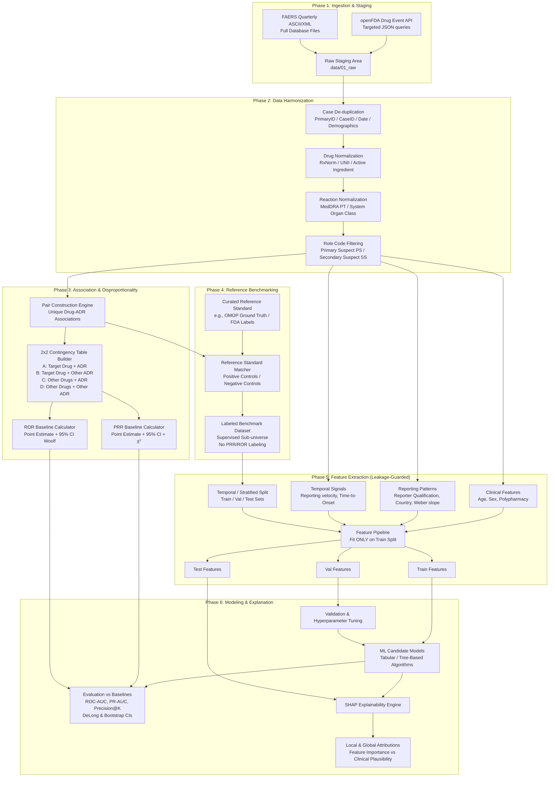

# Research Architecture Blueprint: Explainable AI for ADR Signal Detection in Pharmacovigilance

**Project Title:** Explainable AI Approaches for Adverse Drug Reaction Signal Detection in Pharmacovigilance  
**Data Sources:** FDA Adverse Event Reporting System (FAERS) & openFDA Drug Adverse Event API  
**Baseline Standards:** Proportional Reporting Ratio (PRR), Reporting Odds Ratio (ROR)  
**Interpretability Paradigm:** SHAP (SHapley Additive exPlanations) for Tabular/Tree-Based Attribution  
**Scientific Paradigm:** Observational Signal Detection (Hypothesis Generation, Not Causal Proof)

---

## 1. Project Directory Structure

The proposed project structure is designed around strict separation of concerns, immutability of raw observational data, rigorous pipeline stages, configuration-driven execution, and isolated experiment tracking.

```text
FAERS AI Model/
├── configs/                                # Declarative YAML configurations
│   ├── data_ingestion.yaml                 # Endpoints, FAERS quarters, openFDA params
│   ├── preprocessing.yaml                  # De-duplication rules, vocabulary mappings
│   ├── disproportionality.yaml             # PRR/ROR thresholds, shrinkage parameters
│   ├── reference_standards.yaml            # OMOP, SIDER, or FDA-label benchmark settings
│   ├── feature_engineering.yaml            # Patient demographics, polypharmacy, reporter stats
│   ├── model_candidates.yaml               # Model search spaces, hyperparameter grids
│   └── evaluation.yaml                     # Metric suite, stratification slices, bootstrap runs
│
├── data/                                   # Data storage (git-ignored, versioned via manifest/DVC)
│   ├── 01_raw/                             # Read-only raw data
│   │   ├── openfda/                        # Raw JSON responses from openFDA API queries
│   │   └── faers_ascii/                    # Direct quarterly ASCII/XML FAERS releases (DEMO, DRUG, REAC, etc.)
│   ├── 02_intermediate/                   # Staged tables & parsed records
│   │   ├── normalized_drugs/               # Standardized RxNorm / active ingredient mappings
│   │   ├── normalized_reactions/           # MedDRA Preferred Term (PT) validated events
│   │   └── deduplicated_cases/             # Master case IDs after multi-stage deduplication
│   ├── 03_primary/                         # Clean consolidated event database
│   │   └── drug_reaction_pairs.parquet     # Master 2x2 contingency table candidate universe
│   ├── 04_features/                        # Engineered feature matrices with train/val/test splits
│   │   ├── train_features.parquet
│   │   ├── val_features.parquet
│   │   └── test_features.parquet
│   └── 05_reference_standards/             # Curated, externally established ADR benchmarks
│       ├── omop_ground_truth/              # Positive & negative control drug-event pairs
│       └── reference_mappings.parquet
│
├── docs/                                   # Research methodology and scientific documentation
│   ├── methodology_spec.md                 # Mathematical definitions of PRR, ROR, and ML tasks
│   ├── meddra_rxnorm_vocabularies.md       # Normalization protocols & ontology crosswalks
│   ├── reference_standard_audit.md         # Provenance of positive/negative ADR controls
│   └── bias_and_confounding_notes.md       # Notoriety bias, Weber effect, reporting bias analysis
│
├── experiments/                            # Experiment tracking and run logs
│   ├── run_logs/                           # Timestamped execution logs
│   └── manifests/                          # Run configurations with git commit SHAs and dataset hashes
│
├── notebooks/                              # Strictly for exploratory analysis (read-only against data)
│   ├── 01_openfda_api_exploration.ipynb    # Schema validation and openFDA API query testing
│   ├── 02_faers_quarterly_data_eda.ipynb   # Missingness, report distribution across years
│   ├── 03_contingency_table_eda.ipynb      # Marginal distributions, sparsity, zero counts
│   └── 04_baseline_disproportionality.ipynb# PRR/ROR threshold distribution inspections
│
├── results/                                # Experiment outputs (immutable per run)
│   ├── baseline_scores/                    # PRR, ROR point estimates & 95% CIs
│   ├── model_checkpoints/                  # Serialized trained model pipelines (.joblib / .pt)
│   ├── metrics/                            # Parquet / JSON tables of PR-AUC, ROC-AUC, F1, Recall
│   ├── shap_explanations/                  # Saved TreeSHAP / KernelSHAP values and summary plots
│   └── figures/                            # Publication-grade figures (SVG, PDF, PNG)
│
├── src/                                    # Modular Python package
│   ├── __init__.py
│   ├── common/                             # Shared utilities
│   │   ├── __init__.py
│   │   ├── config.py                       # Pydantic-based configuration schemas
│   │   ├── logger.py                       # Structured scientific logger
│   │   └── reproducibility.py              # Global seed setting, environment fingerprinting
│   │
│   ├── data_acquisition/                   # Data extraction layers
│   │   ├── __init__.py
│   │   ├── openfda_client.py               # Rate-limited openFDA Drug Adverse Event API client
│   │   └── faers_downloader.py             # Batch quarterly archive retriever & unpacker
│   │
│   ├── preprocessing/                      # Cleaning and standardization
│   │   ├── __init__.py
│   │   ├── case_deduplication.py           # Multi-attribute deduplication (FDA_CASE_ID, demographic match)
│   │   ├── drug_normalizer.py              # RxNorm / UNII / ATC active ingredient mapping
│   │   ├── reaction_normalizer.py          # MedDRA PT (Preferred Term) & SOC alignment
│   │   └── missing_data_handler.py         # Missing age, sex, indication characterization & handling
│   │
│   ├── pair_generation/                    # Drug-ADR association generation
│   │   ├── __init__.py
│   │   ├── pair_builder.py                 # Drug-reaction matrix extraction with role filters (Suspect vs Concomitant)
│   │   └── contingency_builder.py          # 2x2 contingency matrix (A, B, C, D) computation engine
│   │
│   ├── baselines/                          # Traditional disproportionality metrics
│   │   ├── __init__.py
│   │   ├── prr.py                          # Proportional Reporting Ratio & 95% CI + chi-square
│   │   └── ror.py                          # Reporting Odds Ratio & 95% CI (Woolf's formula)
│   │
│   ├── reference_standards/                # External validation benchmarks
│   │   ├── __init__.py
│   │   ├── omop_reference.py               # OMOP positive & negative control pair loader
│   │   └── reference_matcher.py            # Strict mapping between FAERS pairs and reference standards
│   │
│   ├── features/                           # Feature extraction & matrix assembly
│   │   ├── __init__.py
│   │   ├── reporting_features.py           # Report volumes, reporter type (physician, consumer), country
│   │   ├── clinical_features.py            # Patient age, sex, polypharmacy count, indication co-occurrence
│   │   ├── temporal_features.py            # Time-to-onset, time since drug approval, reporting trend slopes
│   │   └── feature_pipeline.py             # Leak-free sklearn-compatible feature assembly
│   │
│   ├── modeling/                           # Machine learning model definitions
│   │   ├── __init__.py
│   │   ├── base.py                         # Abstract model base class
│   │   ├── tabular_models.py               # Candidate models (e.g., Logistic, ElasticNet, LightGBM, XGBoost)
│   │   └── hyperparameter_tuning.py        # Nested cross-validation or Bayesian optimization
│   │
│   ├── evaluation/                         # Statistical and benchmark evaluation
│   │   ├── __init__.py
│   │   ├── metrics.py                      # PR-AUC, ROC-AUC, Precision@K, Brier score
│   │   ├── statistical_tests.py            # DeLong test, bootstrap confidence intervals
│   │   └── comparator.py                   # Rigorous side-by-side comparison: ML vs PRR vs ROR
│   │
│   └── xai/                                # Explainable AI and attribution
│       ├── __init__.py
│       ├── shap_engine.py                  # TreeSHAP / KernelSHAP calculation wrapper
│       ├── attribution_analyzer.py         # Global summary & local instance attribution breakdown
│       └── plausibility_checks.py          # Clinical alignment checks of dominant features
│
├── tests/                                  # Unit, integration, and mathematical regression tests
│   ├── test_contingency_builder.py         # Ensure A+B+C+D totals match case universes
│   ├── test_prr_ror_math.py                # Verify PRR/ROR formulas against hand-calculated standards
│   ├── test_deduplication.py               # Test deduplication corner cases
│   └── test_leakage_guards.py              # Ensure test set pairs are absent from training featurization
│
├── .gitignore                              # Git exclusion rules
├── pyproject.toml                          # Dependency specifications and package metadata
├── README.md                               # Project onboarding and reproduction instructions
└── requirements.txt                        # Locked pip dependencies
```

---

## 2. Research Data Flow Architecture

The data moves through distinct validation checkpoints where data integrity, vocabulary alignment, and temporal isolation are verified before advancing.



---

## 3. Modular Responsibilities

| Module | Core Responsibility | Key Scientific Artifacts Produced |
| :--- | :--- | :--- |
| `src.data_acquisition` | Ingests quarterly FAERS packages and openFDA API responses. Enforces rate limits, network retries, and data integrity checksums (SHA-256). | Untampered raw data mirrors in `data/01_raw/`. |
| `src.preprocessing` | Deduplicates records using FDA case identifiers, report dates, and demographic matching. Standardizes drug trade names to active ingredients (RxNorm/UNII) and reactions to MedDRA Preferred Terms (PTs). | Cleaned master case tables; normalization audit logs. |
| `src.pair_generation` | Generates candidate `(drug, ADR)` pairs based on drug role codes (focusing primarily on Primary Suspect `PS` and Secondary Suspect `SS` to mitigate background noise from concomitant medications). Computes the 2x2 contingency matrix `[A, B; C, D]` across the universe of reports. | Primary pairwise dataset with case frequencies and marginal totals. |
| `src.baselines` | Calculates standard pharmacovigilance statistical metrics: PRR, ROR, 95% confidence intervals, and chi-square statistics with Yates' correction. Strictly standalone, zero reliance on ML code. | Classical disproportionality signal scores and baseline ranking tables. |
| `src.reference_standards` | Ingests and maps external reference datasets (such as OMOP Ground Truth or established drug safety reference standards) to the FAERS drug/reaction vocabulary. | High-confidence positive and negative control ground-truth labels for evaluation. |
| `src.features` | Generates multidimensional features: patient demographics, polypharmacy load, reporter qualifications, geographic diversity, reporting trends over time, and reporting velocity. Fits transformations exclusively on training sets. | Split feature matrices (`train_features`, `val_features`, `test_features`). |
| `src.modeling` | Encapsulates tabular and tree-based model architectures with scikit-learn compatible interfaces. Enforces proper regularization and handles class imbalance through specialized objectives or sampling. | Trained model checkpoints with configuration metadata. |
| `src.evaluation` | Conducts head-to-head comparison between ML predictions and PRR/ROR baselines using PR-AUC, ROC-AUC, Brier score, and Precision@K. Computes 95% bootstrap confidence intervals and statistical tests (e.g., DeLong test). | Tabular metric comparisons, PR curves, and ROC curves. |
| `src.xai` | Computes TreeSHAP or KernelSHAP values on test set predictions. Assesses global feature importance and generates local waterfall/force plots for individual drug-ADR pairs to explain signal drivers. | SHAP values, beeswarm plots, and case-level attribution summaries. |

---

## 4. Reproducibility Framework

Scientific pharmacovigilance research demands strict determinism and full auditability:

1. **Declarative Configuration Architecture (`configs/*.yaml`):**
   - Every execution run takes an explicit YAML configuration file specifying: data paths, filtering thresholds (e.g., minimum report count $A \ge 3$), vocabulary version (e.g., MedDRA 26.0, RxNorm 2024AA), model hyperparameters, random seeds, and evaluation metrics.
   - Run scripts must refuse to execute if parameters are hard-coded in python files.

2. **Global Random State Management (`src.common.reproducibility.py`):**
   - A single utility function `set_global_seed(seed: int)` fixes seeds across Python `random`, NumPy, PyTorch (if used), LightGBM/XGBoost, and scikit-learn.
   - Cross-validation splits, bootstrap sampling, and model initializations must draw from explicitly logged seeds.

3. **Data Versioning & Content Hashing:**
   - Raw FAERS quarterly archives and openFDA payloads are read-only.
   - For every processed dataset, the pipeline generates a SHA-256 content hash recorded in `experiments/manifests/run_<timestamp>.json`, linking the processed parquet tables to the exact code commit (Git SHA) and configuration file used.

4. **Structured Experiment Logging (`experiments/run_logs/`):**
   - Structured JSON-lines logging captures execution timestamps, hardware context, Python environment package versions (`pip freeze`), compute duration, and parameter dictionaries for every pipeline step.

5. **Model Checkpoint Management (`results/model_checkpoints/`):**
   - Serialized pipelines include both the feature preprocessing objects and the trained estimators saved together (e.g., via `joblib`), ensuring no divergence between feature preprocessing at training and inference time.
   - Checkpoint names reflect the experiment hash: `model_<run_id>_<algorithm_name>.joblib`.

6. **Saved Evaluation Artifacts (`results/metrics/` & `results/figures/`):**
   - Raw predictions (probabilities), baseline disproportionality values, contingency counts, and ground-truth labels for the test set are saved in structured parquet tables alongside generated scalar metrics, allowing re-plotting or re-analysis without retraining.

---

## 5. Critical Methodological Decisions (Pre-Training Resolution Required)

Before implementing the ML model, the following 11 methodological decisions must be formally decided:

### 1. Definition of a Drug–ADR Pair
- **Decision:** Which drug roles are included when pairing a drug to an adverse event?
  - Options:
    - *Option A:* Only Primary Suspect (`PS`).
    - *Option B:* Primary Suspect (`PS`) and Secondary Suspect (`SS`).
    - *Option C:* All listed drugs including Concomitant (`C`) and Interacting (`I`).
  - *Recommendation:* Restrict to `PS` and `SS`. Concomitant drugs introduce overwhelming background noise and confounding by indication.
- **Minimum Reporting Threshold:** Establish a filter for contingency table cell $A$ (e.g., $A \ge 3$ or $A \ge 5$ reports) to eliminate ultra-sparse pairs that produce unstable statistical estimates.

### 2. Handling Duplicate Reports
- **Decision:** Multi-submission duplicates and follow-up reports (`FDA_CASE_NUMBER` updates) distort disproportionality statistics.
  - Strategy:
    - Identify cases sharing identical `CASEID` / `CASE_NUMBER` and retain only the most recent version (`FDA_DT` or `REPT_DT`).
    - Secondary demographic deduplication: Flag distinct cases sharing exact matching demographic tuples (age, sex, event date, reporting country, active ingredient list).

### 3. Drug-Name Normalization
- **Decision:** In FAERS, drugs are reported as brand names, generic names, chemical names, or with spelling errors (e.g., "Tylenol", "Acetaminophen", "Paracetamol", "APAP").
  - Strategy:
    - Establish a mapping dictionary using the National Library of Medicine (NLM) RxNorm API or openFDA `openfda.substance_name` / `openfda.brand_name`.
    - Map all drug entries to the standard active pharmaceutical ingredient (API) or ATC (Anatomical Therapeutic Chemical) code.

### 4. ADR / Reaction Normalization
- **Decision:** Events are coded using MedDRA (Medical Dictionary for Regulatory Activities).
  - Strategy:
    - Standardize all adverse event terms at the Preferred Term (PT) level.
    - Evaluate whether to aggregate PTs into High-Level Terms (HLTs) or System Organ Classes (SOCs) for broader signal exploration, while evaluating detection performance primarily at the PT level.

### 5. Missing Data Handling
- **Decision:** Spontaneous reporting databases exhibit significant missingness (e.g., missing patient age, weight, indication, or reporter qualification).
  - Strategy:
    - Do not impute patient identity.
    - For numerical features (e.g., age), create explicit binary missingness indicator features (`is_age_missing`) alongside median/cohort imputation to test whether reporting completeness itself correlates with reporting reliability.
    - For categorical variables (e.g., `reporter_country`, `qualification`), preserve `'Unknown'` as an explicit category.

### 6. Feature Construction (Signal Detection Context)
- **Decision:** Features must capture spontaneous reporting dynamics without causing data leakage.
  - Candidate Feature Categories:
    - *Disproportionality signals:* Raw contingency cells ($A, B, C, D$), marginal totals.
    - *Report composition:* Proportion of reports submitted by healthcare professionals (physicians, pharmacists) vs. consumers.
    - *Clinical profile:* Mean age, sex distribution, polypharmacy burden (total concurrent drugs per report).
    - *Temporal dynamics:* Report volume velocity (reports per quarter), time elapsed since first report.

### 7. Class Imbalance
- **Decision:** In pharmacovigilance, true positive ADR associations represent a tiny fraction of all conceivable drug-reaction combinations (often $< 1\%$).
  - Strategy:
    - Avoid naive random undersampling of the majority class, which destroys true marginal event rates.
    - Utilize precision-recall-oriented metrics (PR-AUC) rather than accuracy or ROC-AUC.
    - Consider cost-sensitive learning (class-weighted loss functions) or calibrated focal loss within tree-based models.

### 8. Validation / Reference Dataset (Ground Truth)
- **Decision:** How to establish ground truth without using PRR/ROR (avoiding circular logic).
  - Strategy:
    - Utilize an established scientific benchmark, such as the **OMOP (Observational Medical Outcomes Partnership) Reference Set** or the **EU-ADR reference standard**.
    - OMOP provides curated positive control pairs (proven drug-outcome associations documented in product labels and literature) and negative control pairs (associations with extensive evidence demonstrating no causal link).
    - Under no circumstances should high PRR/ROR values serve as positive labels.

### 9. Train / Validation / Test Strategy
- **Decision:** How should data be partitioned to evaluate generalization?
  - Options:
    - *Random Pair Split:* Randomly assign drug-ADR pairs into train/test sets. (Risk: Drug-level or class-level leakage).
    - *Temporal Split:* Train on reports received up to Year $T$ (e.g., through 2020), test on signal emergence in subsequent years ($T+1$ through $T+N$).
    - *Drug-Disjoint Split:* Ensure all pairs for a specific drug appear only in the train set or test set.
  - *Recommendation:* Prioritize a **Temporal Split** (mimicking real-world pharmacovigilance surveillance where models trained on historical data detect upcoming signals) complemented by a **Drug-Disjoint Split** to test cross-drug generalization.

### 10. Prevention of Data Leakage
- **Decision:** Eliminate temporal and statistical leakage during preprocessing.
  - Strategy:
    - Contingency tables and disproportionality scores must be computed strictly on reports within the designated historical training window.
    - Feature scaling, encoding, and missing value imputations must be fitted on the training split and applied to validation/test sets without updating.

### 11. Evaluation Metrics
- **Decision:** Standard accuracy is scientifically invalid under extreme class imbalance.
  - Core Metric Suite:
    - **PR-AUC (Precision-Recall Area Under Curve):** Primary metric reflecting trade-off between precision and recall across rare signals.
    - **Precision@K (e.g., P@20, P@50, P@100):** Operational pharmacovigilance metric reflecting: "If a safety team reviews the top $K$ alerts flagged by the method, how many are true positive ADRs?"
    - **ROC-AUC:** Secondary comparison for alignment with classical pharmacovigilance literature.
    - **Brier Score / Calibration Curve:** Measures reliability of predicted probability scores.

---

## 6. Proposed Research Milestones

```text
Milestone 1: Environment Setup & Infrastructure Validation
├── Set up modular project directory structure and python package (`src/`)
├── Configure pre-commit quality checks (linting, type annotations, formatting)
└── Build configuration schema and global reproducibility managers

Milestone 2: Data Acquisition & Preprocessing Pipeline
├── Build and validate openFDA Drug Adverse Event API query client (rate-limited)
├── Implement quarterly FAERS ASCII parser and raw ingestion loader
├── Develop multi-tiered deduplication algorithm
└── Implement standardization pipelines for active ingredients (RxNorm) and events (MedDRA PT)

Milestone 3: Contingency Engine & Traditional Baselines
├── Implement 2x2 contingency table generator (A, B, C, D cells)
├── Build independent, verified PRR calculator (with 95% CI and χ² test)
├── Build independent, verified ROR calculator (with 95% CI via Woolf's method)
└── Unit test PRR/ROR formulas against hand-calculated standards and literature examples

Milestone 4: Reference Standard Integration & Alignment
├── Ingest OMOP / EU-ADR reference standard datasets (positive & negative controls)
├── Map reference benchmark drug-reaction pairs to standardized FAERS entities
└── Construct leak-free labeled reference dataset for model training and evaluation

Milestone 5: Feature Engineering & Dataset Splitting
├── Extract patient demographic, reporter qualification, polypharmacy, and temporal features
├── Implement temporal split (train: historic years, test: subsequent surveillance period)
└── Build scikit-learn compatible feature pipeline fitted strictly on training data

Milestone 6: Machine Learning Model Exploration & Tuning
├── Establish baseline classification performance using linear/penalized tabular models
├── Train and tune candidate gradient boosted decision tree models (e.g., LightGBM, XGBoost)
├── Address class imbalance via class weighting and focal loss optimization
└── Conduct nested cross-validation on the training set

Milestone 7: Rigorous Head-to-Head Evaluation
├── Evaluate ML model against PRR and ROR on the held-out test set
├── Calculate PR-AUC, ROC-AUC, Precision@K, and Brier calibration scores
├── Perform 95% bootstrap confidence interval estimation
└── Apply DeLong statistical test for differences in discrimination curves

Milestone 8: Explainable AI (SHAP) Analysis
├── Integrate TreeSHAP calculation engine for top-performing tree-based models
├── Generate global feature attribution summaries (beeswarm plots, mean |SHAP| values)
├── Extract local case-level waterfall explanations for key true positive and false positive signals
└── Perform clinical plausibility audit on top driving features

Milestone 9: Research Synthesis & Reporting
├── Compile consolidated performance tables and publication-quality figures
├── Document study limitations (spontaneous reporting biases, Weber effect, confounding)
└── Produce final research summary report and reproducibility guide
```

---

## 7. Immediate Next Steps & Decision Checkpoints

To proceed with Milestone 1 and prepare the foundational pipeline, the following items require your review and confirmation:

1. **Reference Standard Selection:** Confirm whether we will use the **OMOP Ground Truth Reference Set** (recommended for standardized positive/negative ADR controls) or an alternative reference database.
2. **Data Scope for Initial Development:** Confirm whether we should begin with a bounded historical openFDA dataset (e.g., specific drug class or bounded time window) for pipeline validation before scaling to multi-year FAERS archives.
3. **Role Code Boundary:** Confirm restricting drug-ADR candidate associations to **Primary Suspect (`PS`)** and **Secondary Suspect (`SS`)** roles.
